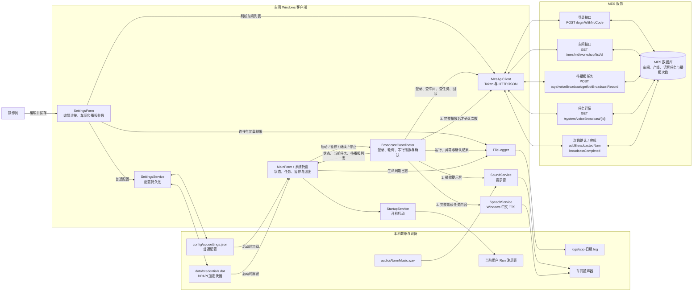

# 安灯语音播报数据流草图

下图按当前代码的最终闭环绘制。客户端只通过 HTTP API 访问 MES，不直接连接 MES 数据库。

## 关键数据约束

1. 车间选择为空时，协调器读取全部车间 ID，并补充 `0` 以覆盖未绑定产线的公共任务。
2. 待播报任务按创建时间和任务 ID 排序，在单个客户端内串行处理。
3. 只有提示音和 TTS 都完整结束，客户端才调用次数确认或完成接口。
4. 确认响应不明确时，客户端先查询任务详情，再决定是否补确认，降低重复播报概率。
5. 暂停、切换设置或退出会取消当前播放且不回写本次次数。
6. 当前 `TerminalCode` 尚未参与后端任务领取；多终端并发消费仍需 MES 增加原子领取或租约机制。
